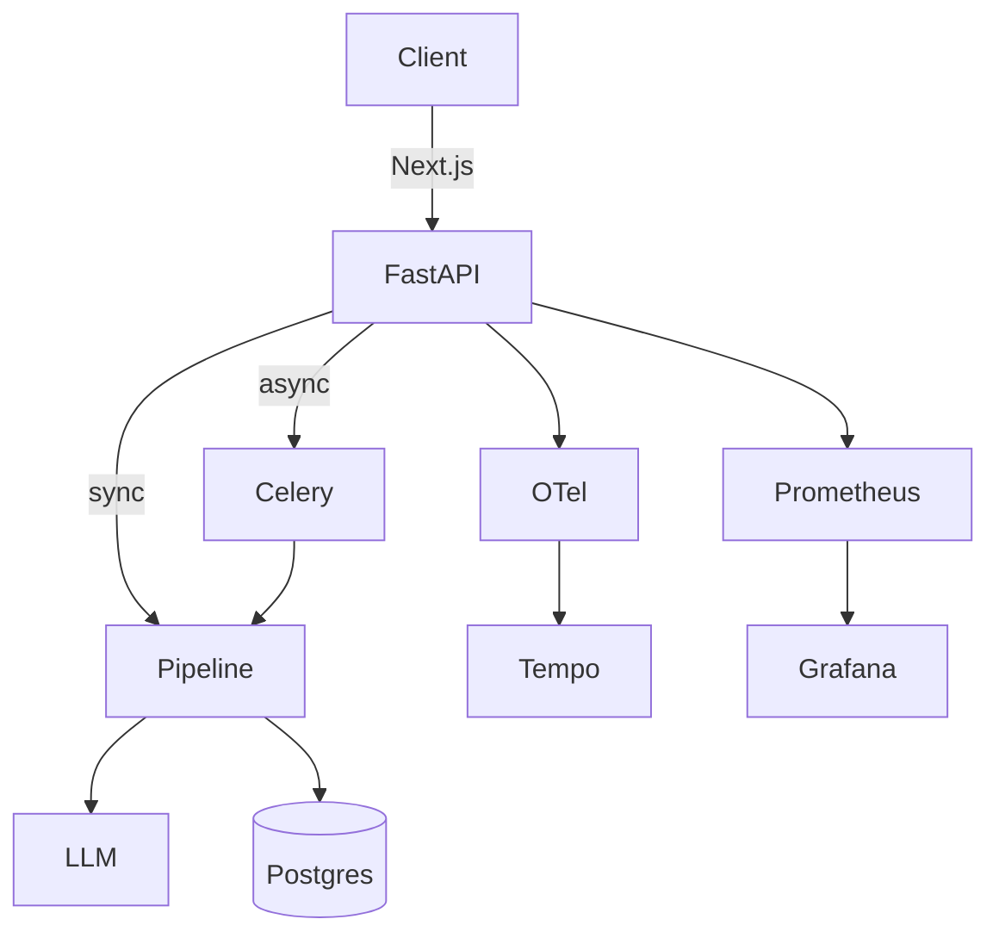

# Vishap

[](https://github.com/dvddv9/vishap/actions/workflows/ci.yml)
[](https://dvddv9.github.io/vishap/)
[](https://badge.fury.io/py/vishap-analyzer)
[](https://hub.docker.com/r/dvddv9/vishap-analyzer)
[](https://www.gnu.org/licenses/agpl-3.0)

> 🔬 6-stage LLM pipeline for analyzing engineering materials (code, spec, logs).

**Vishap** takes a file as input → returns a structured Markdown report with risks, STRIDE threat model, refactoring options and **audit trail** with PII detection and compliance flags.

## 🌐 Links

- **Documentation:** [https://dvddv9.github.io/vishap/](https://dvddv9.github.io/vishap/)
- **Landing Page:** [https://dvddv9.github.io/vishap/landing/](https://dvddv9.github.io/vishap/landing/)
- **GitHub App:** Auto-analyze PR diffs and comment on findings.
- **Docker Hub:** `dvddv9/vishap-analyzer:6.3.0`

## 🚀 What's new in v6.3.0

We have completed the SaaS transformation:

- **UI Next.js (`ui-next/`):** Modern React dashboard (App Router, Tailwind, Clerk auth). Replaces Streamlit.
- **PyPI Trusted Publishing:** Automated publishing via GitHub Actions OIDC (`v6.3.0` on PyPI).
- **CI Fix:** Dogfood Quality Gate (`vishap.yml`) is now non-blocking (Ollama unavailable in CI).
- **Full SaaS Stack:** FastAPI, Celery, Postgres, Clerk (Auth), Stripe (Billing), GitHub App, Docusaurus (Docs), OTel (Observability).

## 🛠 Features

- **6-stage pipeline:** Ingestion → Taint Analysis → Dataflow → Risk Assessment → Verdict → Report.
- **Multi-language:** Python, Java, C (AST + taint patterns).
- **Async API:** FastAPI with Celery workers.
- **Security:** Fernet encryption for secrets, HMAC for webhooks.
- **Observability:** Structlog (JSON), Prometheus `/metrics`, OpenTelemetry traces (Tempo + Grafana).
- **CI/CD:** GitHub Actions (tests, lint, docs deploy, dogfood, PyPI publish).

## 📦 Quick Start

### Docker (recommended)

```bash
docker pull dvddv9/vishap-analyzer:6.3.0
docker run -p 5001:5001 -p 8501:8501 dvddv9/vishap-analyzer:6.3.0
```

- API: `http://localhost:5001/docs`
- UI (Streamlit): `http://localhost:8501`

### Python (PyPI)

```bash
pip install vishap-analyzer==6.3.0
vishap analyze file.py
```

### Local Dev (full stack)

```bash
git clone https://github.com/dvddv9/vishap.git
cd vishap
cp .env.example .env
docker compose up -d
```

- **UI (Next.js):** `cd ui-next && npm install && npm run dev` → `http://localhost:3000`
- **Grafana:** `http://localhost:3001` (admin/admin)

## 🧪 Testing

```bash
python -m pytest tests/ --ignore=tests/test_e2e.py -q
# 553 passed
```

## 📖 Architecture



## 📄 License

GNU Affero General Public License v3.0 (AGPL-3.0). See [LICENSE](LICENSE) for details.
